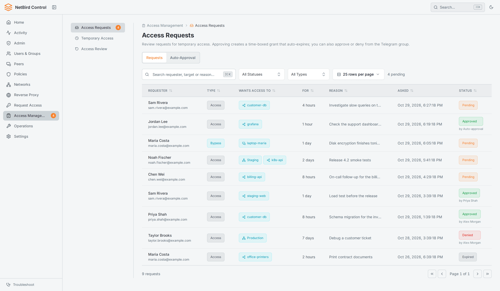
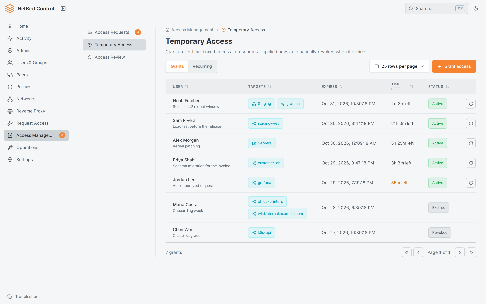
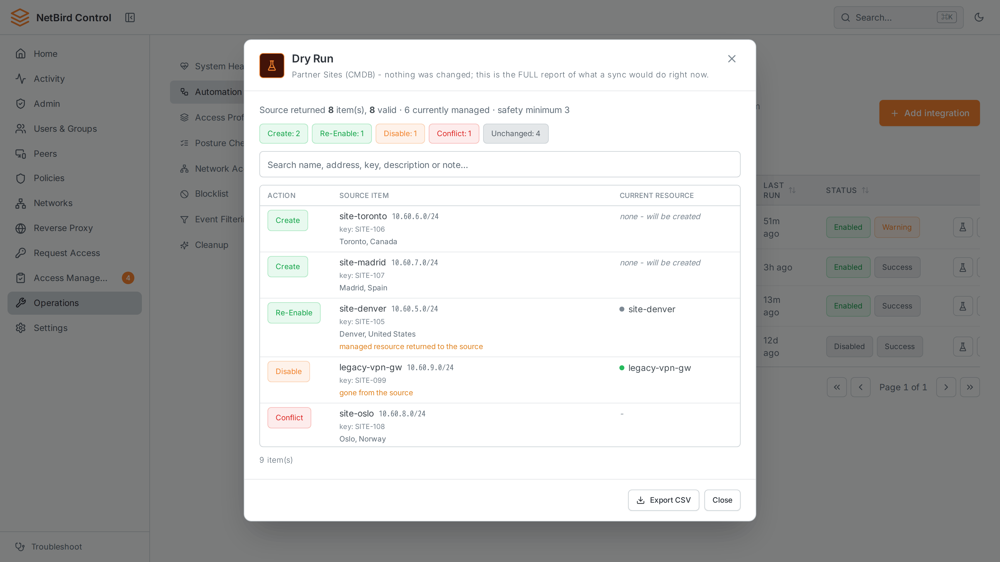
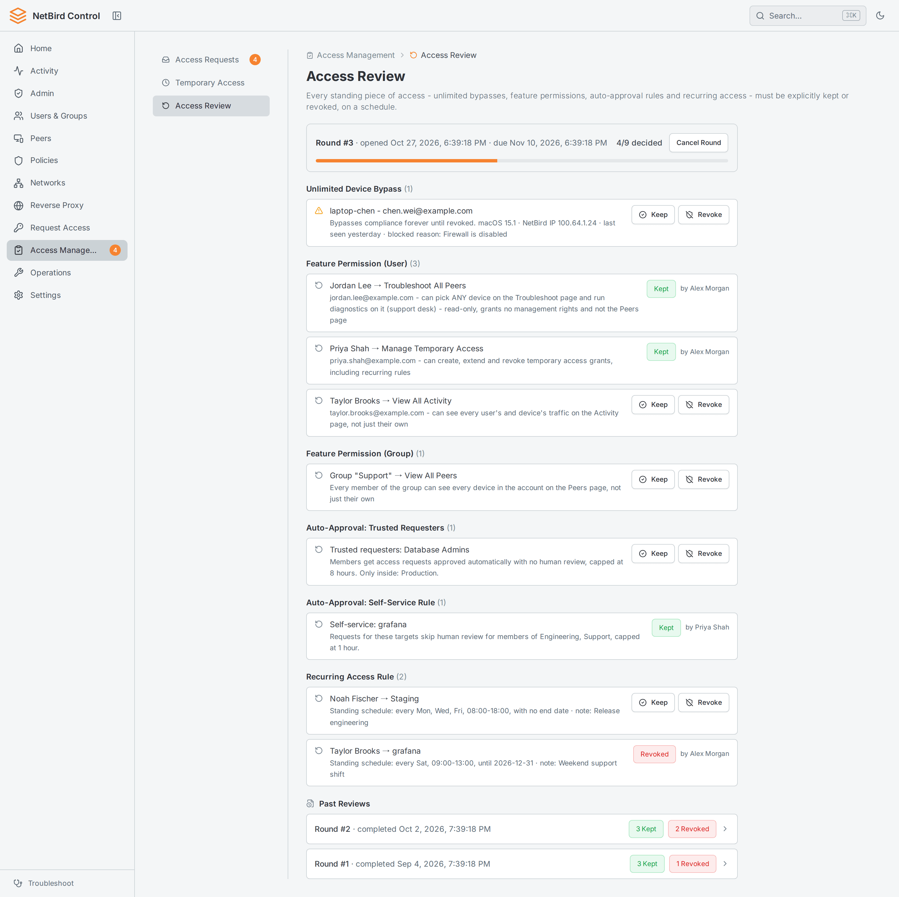
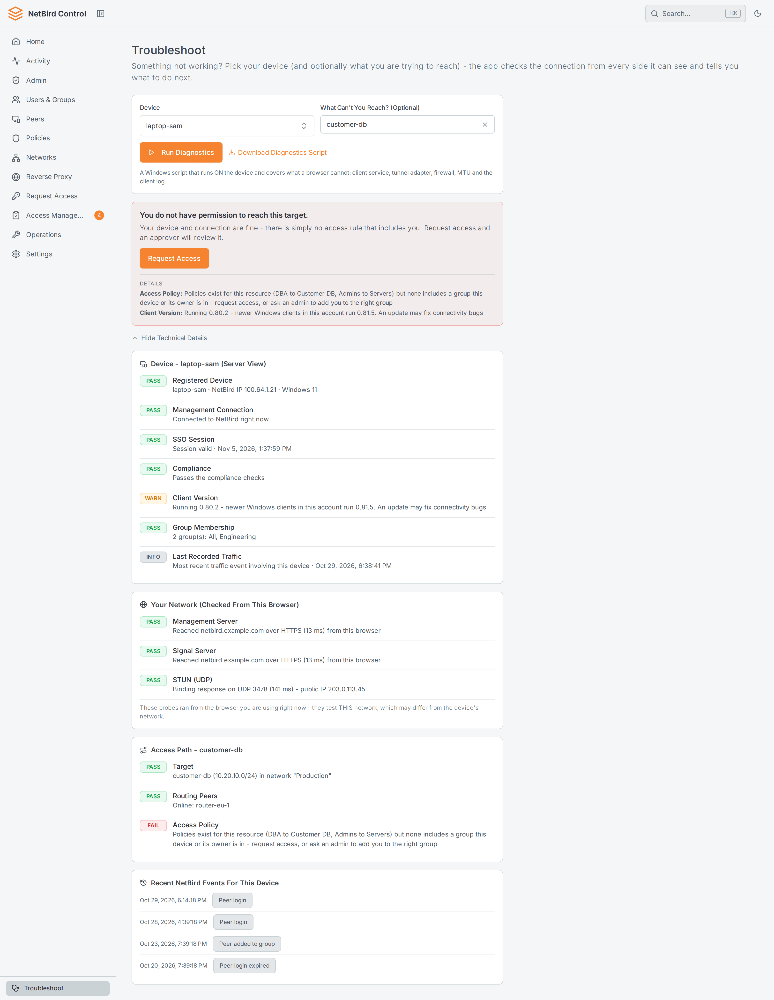
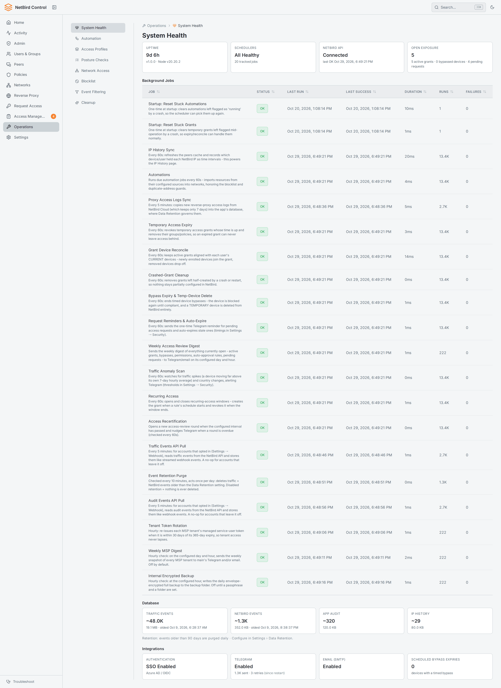

# NetBird Control

A self-hosted companion app for [NetBird](https://netbird.io/). It keeps your NetBird activity in
your own PostgreSQL database and adds what the NetBird dashboard doesn't have: self-service access
requests with approval, time-boxed and recurring access, access reviews, resource automation,
guided troubleshooting, and Telegram alerts. It also manages networks, resources,
policies, users and peers through the NetBird Management API.

> **Disclaimer:** This is an independent community project. It is **not affiliated with, endorsed
> by, or sponsored by NetBird.** "NetBird" is a trademark of its owner and is used only to describe
> interoperability. See [Credits and licensing](#credits-and-licensing).


https://github.com/user-attachments/assets/d48319ad-5146-4b4a-8aad-544edc3f1b78


## Screenshots

| | |
|---|---|
| **Access requests** - approve or deny in the app or from Telegram | **Temporary access** - time-boxed grants that remove themselves |
| <picture><source media="(prefers-color-scheme: dark)" srcset="docs/screenshots/access-requests-dark.png"></picture> | <picture><source media="(prefers-color-scheme: dark)" srcset="docs/screenshots/temporary-access-dark.png"></picture> |
| **Automation** - create resources from an external source, with a dry run | **Access review** - periodic keep or revoke rounds over standing access |
| <picture><source media="(prefers-color-scheme: dark)" srcset="docs/screenshots/automation-dark.png"></picture> | <picture><source media="(prefers-color-scheme: dark)" srcset="docs/screenshots/access-review-dark.png"></picture> |
| **Troubleshoot** - a plain-language connectivity diagnosis for any device | **System health** - background jobs, integrations and database status |
| <picture><source media="(prefers-color-scheme: dark)" srcset="docs/screenshots/troubleshoot-dark.png"></picture> | <picture><source media="(prefers-color-scheme: dark)" srcset="docs/screenshots/system-health-dark.png"></picture> |

## What it adds to NetBird

- **Activity history you own** - traffic and audit events from NetBird's event streaming or API,
  searchable, summarized per conversation, with your own retention and an IP history for forensics.
- **Access requests** - users request access to a resource; approvers decide in the app or from
  Telegram. Auto-approval rules and approval delegation are built in.
- **Temporary and recurring access** - least-privilege grants that expire on time, and weekday
  schedules that grant and revoke access automatically.
- **Access reviews** - recertification rounds over all standing access, with the context needed
  to keep or revoke each item.
- **Automation** - create, update and remove NetBird resources from an external HTTP source on a
  schedule, with a dry run before anything is written.
- **Troubleshooting** - device, network and access-path checks that tell a user what is wrong and
  what to do next, plus a downloadable Windows diagnostics script.
- **Guardrails** - an address blocklist, overlap and conflict detection, a cleanup report and a
  read-only mode for the NetBird API.
- **Notifications** - Telegram topics per category, email to people who request access, anomaly
  alerts and a weekly digest.
- **Delegated administration** - SSO with Entra ID, feature permissions for non-admins, and
  per-network edit rights by group.
- **MSP tenants** - manage NetBird Cloud customer accounts from one place, each fully isolated.

The full list is in [docs/features.md](docs/features.md), and each feature's mechanics are in
[docs/](docs/README.md).

## Quick start

```bash
git clone https://github.com/shlomiporush/netbird-control.git
cd netbird-control
cp .env.example .env   # set at least DB_PASSWORD
docker compose up -d
```

`docker compose` runs `ghcr.io/shlomiporush/nbcontrol` and PostgreSQL. Open
**http://localhost:3000**. The web interface needs a current browser: Chrome or Edge 111,
Safari 16.4 or Firefox 128 or later.

> **Without SSO the app is fully open:** anyone who can reach it is an admin. Run it that way only
> on a trusted network, and configure SSO for anything else (see [Security](#security)).

### Connect NetBird

1. Create a service user and a personal access token in NetBird, then enter the API URL and the
   token in **Settings → NetBird API** (or set `NETBIRD_API_URL` and `NETBIRD_API_TOKEN`). Without
   it, the app is only an activity log viewer.
2. Set `BASE_URL` to the app's address as NetBird can reach it (for NetBird Cloud, a public HTTPS
   URL), then use **Configure In NetBird Automatically** in **Settings → Webhook** to create the
   event streaming and account notification integrations. Event streaming depends on your NetBird
   plan; without it, turn on **Traffic Events API Pull** and **Audit Events API Pull** on the same
   page. The manual setup is in [docs/features.md](docs/features.md#connecting-netbird-events).

## Configuration

Most settings are stored in the database and edited in the app (**Settings**). The environment
covers the database, SSO and a few locked values:

| Variable | Description |
|---|---|
| `PORT`, `TAG` | The host port to publish (the app listens on 3000 inside the container), and the image tag to run (`latest` or a version) |
| `DB_HOST`, `DB_PORT`, `DB_NAME`, `DB_USER`, `DB_PASSWORD` | PostgreSQL connection (**change the password**) |
| `OIDC_ISSUER_BASE_URL`, `OIDC_CLIENT_ID`, `OIDC_CLIENT_SECRET`, `BASE_URL` | SSO with Entra ID; setting all four turns SSO on ([setup guide](docs/sso-entra-id.md)). **New requirement:** if any `OIDC_*` variable is set, all four are required, or the app does not start. `BASE_URL` alone does not turn SSO on, and is also needed for the one-click NetBird setup |
| `SESSION_SECRET` | A fixed session secret (`openssl rand -hex 32`). Without it, every restart signs everyone out |
| `ADMIN_GROUP_ID` | Entra group whose members are admins, in addition to NetBird owners and admins |
| `NETBIRD_API_URL`, `NETBIRD_API_TOKEN` | NetBird Management API (can also be set in the app) |
| `NETBIRD_READONLY` | `true` blocks every write to NetBird |
| `WEBHOOK_AUTH_TOKEN` | Bearer token for `POST /api/webhook` (can also be set in the app) |
| `TRUST_PROXY` | The reverse proxy allowed to report the client address (`X-Forwarded-For`): its address or CIDR (comma-separated for several), or a hop count. Empty (default) uses the connecting address and ignores the header. Behind a proxy, set it to that proxy, and make sure the app port is not also reachable directly |
| `TELEGRAM_BOT_TOKEN`, `SMTP_*` | Notifications (can also be set in the app) |
| `EVENT_PURGE_ADMINS` | Emails allowed to delete stored events |

[`.env.example`](.env.example) documents every variable.

## Security

- **SSO** - with the three `OIDC_*` variables and `BASE_URL` set, every page requires login. Admins are
  NetBird owners and admins, or members of `ADMIN_GROUP_ID`; everyone else sees only their own data
  and what they were granted. If any `OIDC_*` variable is set but one of the four is missing, the
  app does not start and logs which ones are missing.
- **Rate limits** apply to everything except the webhook receivers (sign-in 30 requests a minute per
  client address, the API 600 and pages 300 a minute per user). The receivers are not rate limited, so
  any deployment that others can reach should set `WEBHOOK_AUTH_TOKEN` (and the notifications token
  in **Settings → Webhook**) and register the Telegram webhook, which sets its secret.
- **Secrets** are write-only: they are never sent back to the browser, and a value from the
  environment locks the field in the app.
- **Destructive actions are gated** - with SSO on, deleting stored events needs an admin listed in
  `EVENT_PURGE_ADMINS`, and blocklist enforcement always needs an explicit scan, review and confirm.
- **Run one instance** - schedulers and caches live in the process, so a second replica would run
  every job twice.

More in [docs/permissions-and-security.md](docs/permissions-and-security.md).

## Development

You need Node.js 24 (the version the image uses; 22.12+ also works) and a PostgreSQL database the
backend can reach. The backend reads `.env` from its working directory, so put the `DB_*` settings in
`backend/.env` (or export them).

```bash
cd frontend && npm install && npm run build   # Vite builds into backend/public
cd ../backend && npm install && node server.js
```

Run the unit tests from the repository root with `cd backend && npm test`. Use `npm run dev` in
`frontend/` for hot reload against a running backend. To build the image
yourself: `docker build --target prod -t nbcontrol:local .`. The API reference is served at
`/api/docs`.

## Credits and licensing

This project interoperates with NetBird and its UI **look-and-feel is derived from NetBird's open-source dashboard**, which is licensed under **AGPL-3.0**. The styling reuses NetBird's design tokens and component class conventions. Full credit for that design goes to the NetBird project - <https://github.com/netbirdio/dashboard>.

The original application code in this repository (backend, the React app structure, the automation engine, etc.) is provided under the **MIT License** - see [`LICENSE`](LICENSE). Because the visual layer is derived from AGPL-licensed work, **if you redistribute or publicly host a modified version, review NetBird's AGPL-3.0 terms** and ensure your use complies. This README is not legal advice.

Third-party material (the country flags) and its licenses are listed in [`NOTICE`](NOTICE).

"NetBird" and related marks belong to their respective owner; this project is independent and not affiliated with NetBird.
